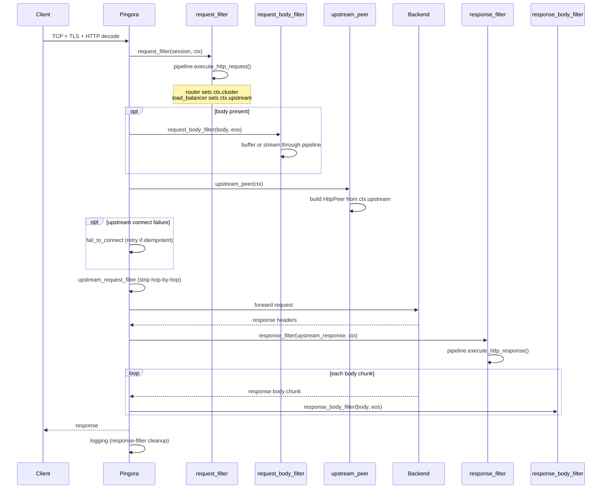

+++
title = "Connection Lifecycle"
type = "guides"
body_class = "historical-archive-page"
version_archive = true
exclude_search = true
url = "/archive/old-site/docs/architecture/connection-lifecycle/"
archive_title_in_content = true
+++

# Connection Lifecycle

> **Historical archive.** This unversioned page is preserved from the old website at commit <code>43fb08a65bdf4341d78adb829ffcd6cc5e4d8131</code> (2026-10-21). Its instructions may not match current releases. Read the [current guidance](/docs/architecture/connection-lifecycle), [exact Markdown source](/archive/old-site/source/docs/architecture/connection-lifecycle.md), and [original site license](/archive/old-site/source/LICENSE).

## HTTP Connection Lifecycle

1. TCP accept, TLS handshake, HTTP decode (Pingora)
2. `request_filter`: pipeline runs filters in order; router
   sets `ctx.cluster`, load balancer sets `ctx.upstream`
3. `request_body_filter`: buffer or stream body chunks
   through filters (if any filter declares body access)
4. `upstream_peer`: converts `ctx.upstream` to `HttpPeer`
5. Connect to upstream; `fail_to_connect` retries
   idempotent requests on failure
6. `upstream_request_filter`: strips hop-by-hop headers
7. Request forwarded, response headers received
8. `response_filter`: pipeline runs filters in reverse
9. `response_body_filter`: stream response body through
   filters (synchronous; Pingora constraint)
10. `logging`: re-runs response filters if response
    phase was skipped (upstream error, filter rejection)
11. Connection returned to pool

## TCP Connection Lifecycle

1. TCP accept, optional TLS handshake
2. `on_connect` : TCP filters run in order
3. Bidirectional byte forwarding to upstream
4. `on_disconnect` : TCP filters run on close

## Related

- [Architecture Overview](/archive/old-site/docs/architecture/overview/)
- [Payload Processing](/archive/old-site/docs/architecture/payload-processing/)
- [HTTP Correctness](/archive/old-site/docs/architecture/http-correctness/)
